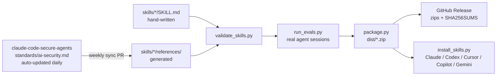

# Architecture

## Components

| Component | Role |
|---|---|
| `skills/*/SKILL.md` (e.g. `skills/threat-model/SKILL.md`) | The skill: frontmatter (name, description, version, licence) plus a short procedure. Hand-written, kept under the token budget. |
| `skills/*/references/` | The security standard split into one file per section, plus `KIT_VERSION.txt`. Generated; never edit by hand. |
| `skills.json` | Skill list, licence per skill, and the kit repo/ref used as the source of the standard. |
| `scripts/sync_from_kit.py` | Splits the kit's standard into sections with short, stable file names and writes them into every skill. |
| `scripts/validate_skills.py` | Format rules (Agent Skills spec), packaging rules, token budgets, licence per skill, references present, no secrets or executables. |
| `scripts/run_evals.py` | Runs eval cases in real headless agent sessions and gates releases. See [quality.md](quality.md). |
| `scripts/extract_sarif.py` | Extracts and validates the SARIF block a review prints, for CI and code scanning. |
| `scripts/package.py` | Reproducible zips plus `dist/SHA256SUMS`; one zip per skill, e.g. `dist/threat-model-1.1.0.zip` containing `threat-model/SKILL.md` (no nested zips), plus an optional pack. |
| `scripts/install_skills.py` | Installs, updates, lists and removes skills for each supported agent. |

## Design decisions

1. **One source of truth for the standard.** The kit already tracks OWASP, NIST, MITRE ATLAS and Claude Code changes and ships only additive, gated updates. The skills reuse it instead of keeping a second copy that would drift.
2. **Progressive disclosure for cost.** Only the description (≤ 420 characters) loads at session start. `SKILL.md` (≤ ~1,600 tokens) loads when the skill runs. Standard sections load one at a time, only when relevant. §11 application security, §12 engineering and §15 agent rules are always read for code changes.
3. **Every skill is self-contained.** Each zip ships the whole standard so it works on its own. Unused sections cost nothing, because they are never loaded.
4. **Agent-neutral wording.** The skills don't rely on any one agent's features. `secure-feature-build` uses subagents for planning and review where available, and otherwise runs each gate itself with a fresh review pass.
5. **Read-only by default.** Review, threat-model and vetting skills never modify files; the eval suite checks this.

## Release flow

1. Change a skill, or merge the weekly sync PR.
2. CI runs `validate_skills.py` and `package.py` on every push and PR. The eval workflow runs when skills or evals change.
3. Bump `metadata.version` in each changed `SKILL.md` (semver: patch for wording or reference sync, minor for new behaviour, major for a changed output format).
4. Update [CHANGELOG.md](../CHANGELOG.md), merge, and tag the date, e.g. `v2026.11.18`.
5. Pushing the tag runs `release.yml`, which publishes a GitHub Release with every zip and `SHA256SUMS`.

## Versioning
- **Skills** carry their own semver in `metadata.version`; users see that number.
- **Repository releases** are date-tagged and listed in the changelog.
- `KIT_VERSION.txt` in each skill records which kit version its standard came from.
